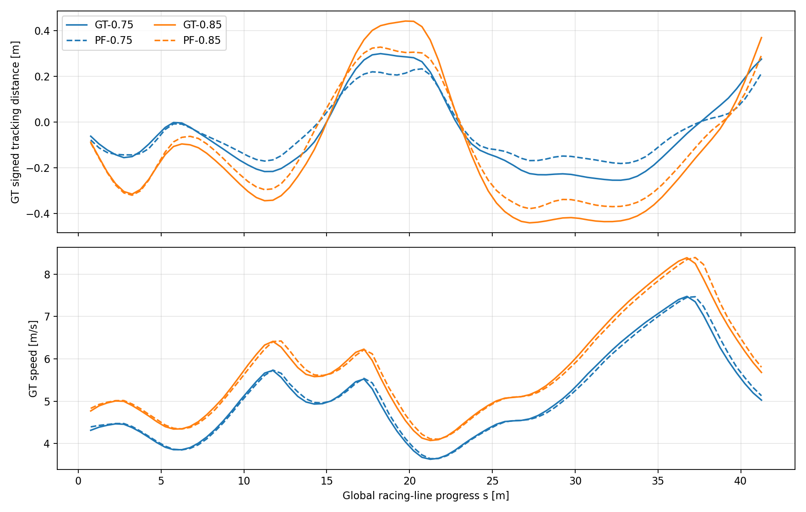

# EXP-001 대 EXP-002 — GT/PF 입력 비교

## 결론
**초기 위치를 정상적으로 제공한 조건에서 GT와 PF 모두 0.75까지의 대표 실행은 완주했고, 0.85에서는 유사한 코너에서 실패했다.** PF 오차가 주행에 영향을 줄 가능성은 있지만, 높은 배율의 실패를 PF 단독 원인으로 설명할 수는 없다. 속도에 따른 PP 추종 문제와 위치 추정의 영향을 구분해 후속 검증한다.

이 결과는 기본 탐색의 관찰이며 성공률, 최적 속도, 원인의 확정을 의미하지 않는다. 사용자의 계획대로 EXP-003~004를 먼저 관찰하고 PP 튜닝은 이후로 미룬다.

## 실험 조건과 변경 사항

| 항목 | EXP-001 | EXP-002 |
|---|---|---|
|컨트롤러|PP C++|PP C++, 튜닝 설정 유지|
|위치 입력|GT|PF|
|맵 / 장애물|hyhall12 / 0개|동일|
|초기 상태|초반 수동 출발, 후반 고정 pose|GT 고정 pose + PF 시작 prior|
|완주·충돌 평가|GT 기준|GT 기준|
|속도 탐색|0.25~1.00|0.25~0.85, 이후 0.80 추가|

PF 시작 prior 정비는 필터의 초기화 조건을 변경한 것이다. 센서·운동모델 계수나 PP lookahead를 튜닝하지 않았고, GT를 주행 중 PF에 계속 제공하지 않았다. EXP-001 초기 저배율 주행은 수동 출발이었으므로 모든 배율에서 완전한 초기 조건 통제를 주장하지 않는다.

## 완주와 랩타임

| 배율 | GT 대표 결과 | PF 대표 결과 |
|---|---|---|
|0.25|3랩 무충돌, 평균 24.973초|3랩 무충돌, 평균 24.957초|
|0.35|3랩 무충돌, 평균 17.852초|3랩 무충돌, 평균 17.820초|
|0.45|3랩 무충돌, 평균 13.880초|3랩 무충돌, 평균 13.883초|
|0.55|5랩 무충돌, 평균 11.4038초|3랩 무충돌, 평균 11.397초|
|0.65|3랩 무충돌, 평균 9.711초|3랩 무충돌, 평균 9.721초|
|0.75|고정 출발 R06-retry5, 3랩 무충돌, 평균 8.514초|3랩 무충돌, 평균 8.550초|
|0.80|미실험|1랩 8.120초 통과 직후 충돌, 계측 +8.129초|
|0.85|첫 랩 +7.700초에 충돌|첫 랩 +7.699초에 충돌|
|0.95|첫 랩 +3.589초에 충돌|미실험|
|1.00|첫 랩 +3.469초에 충돌|미실험|

랩타임은 벽시계 기준이며 실행 부하의 영향을 포함한다. GT 0.55는 관찰을 5랩으로 연장했던 기록으로 PF 3랩과 반복 수가 다르다. GT 최초 R06은 실제 배율이 0.65였으므로 0.75 비교에서 제외하고 고정 출발 재실행을 사용했다.

## 동일 배율·동일 경로·동일 지표 비교
양쪽 bag이 있는 **0.75와 0.85**를 비교했다. 성공 실행은 첫 계측 랩만, 실패 실행은 첫 충돌 전까지만 사용했다. 네 실행의 GT 초기 위치·방향·속도 0이 정확히 같고 기록된 글로벌 경로 형상도 같음을 검사했다.

GT XY에서 글로벌 레이스라인의 선분까지 거리를 다시 계산하고, 경로 진행거리 `0.5 ≤ s < 41.5m`의 0.5m 간격 82개 공통 구간을 동일 가중으로 비교했다. PF 기반 Frenet d를 GT 실제 이탈과 혼합하지 않았다. 각 실행의 기존 요약은 전체 계측 구간의 시간 표본 평균인 반면 아래 수치는 첫 주행의 공간 평균이므로 값이 달라도 모순이 아니다.

| 배율 / 입력 | 공통 경로 평균 실제 vx | 공간 평균 실제 경로 이탈 |
|---|---:|---:|
|0.75 / GT|5.08m/s|15.81cm|
|0.75 / PF|5.09m/s|11.94cm|
|0.85 / GT|5.71m/s|27.40cm|
|0.85 / PF|5.72m/s|22.69cm|

관찰된 실제 속도는 같은 배율끼리 비슷했고, 양쪽 모두 0.85에서 0.75보다 실제 이탈이 컸다. 이 네 실행에서는 PF의 공간 평균 거리가 더 작았지만 **PF가 GT보다 본질적으로 우수하다고 해석하지 않는다.** 추정 편향이 제어 궤적을 이동시키거나 기존 코너 이탈을 부분적으로 상쇄할 수 있고, PF 난수·비동기 입력·실행 부하 등이 섞여 있다. 배율별 독립 반복이 충분하지 않아 유의성이나 일반적인 우열을 추정하지 않는다.

0.85의 GT 충돌점 `(11.386, 0.278)`과 PF 충돌점 `(11.437, 0.240)`의 거리는 약 6.4cm다. 관찰상 같은 코너의 실패로 보이며, PF에만 존재하는 실패 양상으로 볼 근거는 부족하다.

## 문제 분류

| 분류 | 근거 | 현재 판단 |
|---|---|---|
|PF 초기 측위 실패|최초 R01 출발 전 3.91m / 약 180° 오차|전역 초기화 상태의 잘못된 해를 주행에 사용. 시작 prior 정비 후 별도 기준 확보|
|PF 주행 중 위치·헤딩 오차|각 실행 PF-GT 표본|측정됨. GT 실제 추종 오차와 분리해서 분석|
|높은 배율에서 공통 추종 실패|GT/PF 0.85의 유사 코너 충돌|PP lookahead·감속·차량 동역학의 공통 영향 후보. 주원인 미확정|
|0.80 목표 미달|PF는 1랩 직후 충돌|3랩 완주 성공으로 세지 않음. GT 0.80은 없어 동일 배율 대조 불가|

PF 평균 위치 오차는 성공 0.75에서 약 15.9cm, 실패 0.85에서 약 12.1cm다. 평가 구간이 달라 수치만으로 PF 오차가 작을수록 실패한다거나 0.85의 측위가 개선됐다고 해석할 수 없다. 실패 여부와 측위 오차의 전체 평균 하나만으로 원인을 정하지 않는다.

## 남겨둘 가설과 후속 순서
1. 속도 비례 PP lookahead가 코너에서 너무 길어지는지 검증한다. 기존 EXP-001 재구성은 가설 근거이며 실제 내부 L1/목표점을 직접 녹화한 값은 아니다.
2. 횡오차·헤딩 감속이 큰 실제 이탈에 충분히 반응하는지 확인한다. PF 기준 오차와 GT 기준 오차의 차이도 함께 본다.
3. 컨트롤러 입력 속도 지연과 PF 위치·방향 오차의 영향을 분리한다.

이 검증들은 EXP-003~004 기본 관찰 뒤에 수행한다. 나중에 파라미터 하나만 변경하고 같은 고정 초기 조건에서 재현·부작용을 확인한다. 이번 비교 작업에서는 제어 파라미터나 현재 배율 0.80을 변경하지 않았다.

## 재현과 한계
- [재현 스크립트](compare.py), [정량 결과](comparison.json), 각 조건 `*_trace.csv`를 보존했다. 원본 bag을 같은 상대 경로에 두고 ROS 환경에서 `python3 analyses/EXP-001-vs-002/compare.py`를 실행한다.
- 구간 경계는 scorer 벽시계 로그, 표본 시각은 bag 수신 시각이다. 센서/명령의 정밀 동기화 오차를 완전히 제거한 분석은 아니다.
- 각 조건의 실행 수가 적고 PF 입자 난수는 race_manager seed와 별개다. 장애물 없는 hyhall12 결과를 다른 맵·장애물·컨트롤러에 일반화하지 않는다.
- PF 검사 파일 `start_check.json`은 각 주행 폴더에서 확인되지 않았다. 검사 통과 대신 실제 bag의 출발 전 PF-GT 오차로 초기 상태를 검증했다.
- rosbag 원본은 용량 때문에 Git에서 제외돼 있다. 공개 문서·지표·그래프는 열람 가능하지만 원본부터 재분석하려면 로컬 bag이 필요하다.

자료: [EXP-001 요약](../../runs/EXP-001/SUMMARY.md), [EXP-002 요약](../../runs/EXP-002/SUMMARY.md), [전체 결과표](../../results.csv), [PF 초기화 정비](../../configs/pf_initialization_validation/README.md).
