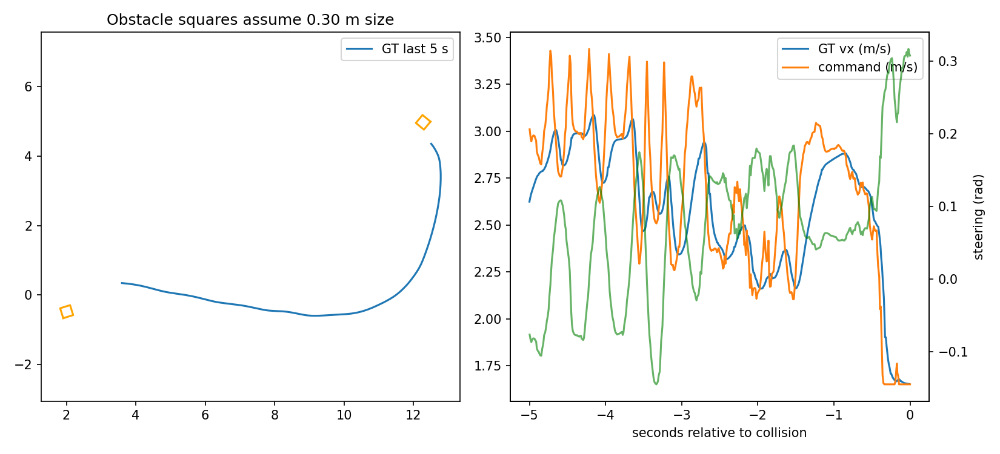
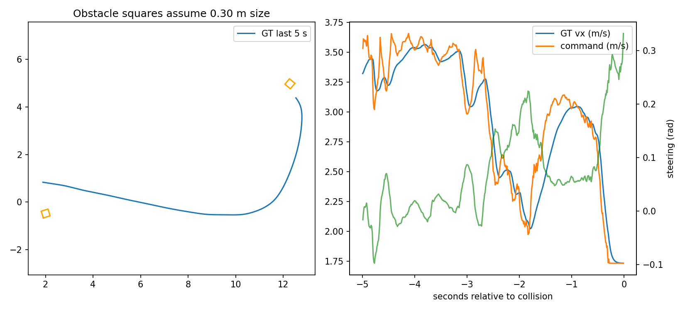

# TLN 파라미터 튜닝을 통한 성능 변화와 한계 분석

실험: EXP-007 · 작성일: 2026-10-30 · 환경: hyhall12 시뮬레이션

## 1. 결론

이번 실험은 TinyLidarNet(TLN)의 모델을 재학습하는 대신, 속도 매핑 범위·조향 평활화(EMA)·코너 감속 가중치를 조정하여 주행 변화와 한계를 관찰한 실험이다. 일부 조건에서는 무충돌 주행을 확보했으나, 속도를 높이거나 장애물 조건을 확장했을 때 특정 배치의 회피 실패가 남았다. 따라서 **후처리 파라미터 튜닝으로 속도와 주행 안정성을 조정할 수 있었지만, 현재 모델과 제어 구성의 장애물 회피 강건성을 확보하지는 못했다.**

핵심 근거는 다음과 같다.

- 장애물 1개, EMA 0.5, 기본 속도 범위의 0.50배에서 독립 실행 2회가 각각 7랩·5랩 무충돌이었다.
- 장애물 2개로 늘린 동일 TLN 설정은 관찰한 4랩에서 무충돌이었다. 목표 7랩 전체의 성공은 확인하지 않았다.
- 장애물 2개에서 속도를 단계적으로 올린 R13과 R14는 모두 5랩 완료 후 여섯 번째 배치의 동일 장애물 부근에서 충돌했다. 충돌 지점 차이는 약 3.3cm였다.
- R14는 R13보다 평균 랩타임이 약 5.5% 짧았지만, 반복된 회피 실패를 해결하지 못했다.

이 결론의 범위는 **현재 TLN_aug.keras 모델·후처리 구현·차량 시뮬레이터·맵·seed에서 관찰한 한계**다. TLN 계열 전체의 성능 한계나 실제 차량의 성능으로 일반화하지 않는다.

## 2. 실험 목적과 구성

목적은 파라미터 조정으로 주행이 얼마나 개선되는지 확인하고, 개선되지 않는 실패 양상을 찾아 튜닝의 적용 범위와 남은 문제를 정리하는 것이다. 모델 재학습·새 회피 알고리즘·안전 정지 제어기는 추가하지 않았다.

| 항목 | 조건 |
|---|---|
| 맵 | hyhall12 |
| 모델 | TLN_aug.keras |
| 제어 흐름 | /scan → 신경망 → 조향·속도 후처리 → /drive |
| 위치 추정 | PF 실행 및 출발 검사, TLN의 직접 입력에는 사용하지 않음 |
| 장애물 | seed 2026, 실험에 따라 1개 또는 2개, 랩 경계에서 배치 변경 |
| 기본 속도 범위 | 3.0~6.5m/s를 기준으로 매핑 범위 조정 |
| 공통 설정 | 조향 상한 0.36rad, LiDAR 클램핑 10m, down_sample=2, mapping=false |
| 평가 | 완료 랩, 랩타임, 장애물/벽 충돌, 복구 여부, GT 속도·궤적, 조향 명령 |
| 보존 자료 | 결과 JSON·PNG, 실행 YAML, PF 출발 검사, 원본 rosbag 및 일부 오프라인 분석 |

TLN은 PP/MAP 제어기, 조향 LUT, 상태 머신, 로컬 플래너, 장애물 검출·추적 결과를 직접 사용하지 않는다. 기존 speed_scaler의 global_limit도 TLN 속도에 적용되지 않는다. 따라서 이번 튜닝은 TLN 노드의 파라미터를 실행별 YAML로 지정했다. 공유 소스 기본값을 바꾼 것과 실행 당시 override를 구분해야 한다.

동일 seed라도 장애물 개수가 달라지면 배치가 달라질 수 있다. 장애물 1개와 2개 결과를 장애물 수만의 순수 효과로 해석하지 않는다. 동일 조건 반복도 실제 좌표·방향을 bag으로 확인한 범위에서 비교한다.

## 3. 조정한 파라미터와 동작

### 속도 범위: v_min, v_max

모델 속도 출력을 설정 범위로 선형 매핑하고, 조향 크기에 비례한 감속을 적용한 뒤 최종적으로 v_min~v_max 범위로 제한한다. 따라서 범위를 절반으로 줄였다고 실제 속도나 랩타임이 정확히 절반 관계가 되는 것은 아니다.

현재 구현은 양의 v_min보다 낮은 속도 명령을 허용하지 않는다. 장애물이 가까워도 이 후처리만으로는 정지 명령을 만들 수 없다는 구조적 제약이 있다.

### 조향 EMA: ema_alpha

조향 명령은 `이전 EMA × (1-alpha) + 모델 조향 × alpha`로 계산한다. 0.7에서 0.5로 낮추어 평활화를 강화했다. 작은 alpha는 모델 조향의 즉각적인 반영을 줄이지만, 실제 반응 지연과 궤적 변화도 만들 수 있다.

평활화된 조향이 코너 감속 계산에도 쓰이므로 EMA 변경은 조향과 속도 명령 모두에 영향을 준다. EMA 효과를 순수한 조향 평활화 효과로만 해석하지 않는다.

### 코너 감속 가중치: curve_speed_weight

가중치를 0.65에서 0.80으로 올려 큰 조향 구간의 감속을 강화했다. 그러나 해당 실행은 첫 귀환 코너의 벽 충돌로 종료되어 개선을 확인하지 못했다. 강한 감속이 항상 더 안전한 궤적으로 이어지는 것은 아니었다. 단일 실행으로 가중치 증가의 일반적인 성능 저하를 확정하지는 않는다.

## 4. 실험 결과

속도 배율은 기본 매핑 범위 3.0~6.5m/s 대비 비율이다. 평균은 완료된 랩의 산술평균이며, 이후 충돌까지 걸린 시간은 평균에 포함하지 않았다. `완료 랩`과 `전체 실행의 충돌`을 구분한다.

| 실행 | 장애물 수 | 속도 배율 | EMA | 감속 가중치 | 완료 랩 | 평균 랩(s) | 전체 실행 결과 |
|---|---:|---:|---:|---:|---:|---:|---|
| R01 | 2 | 1.00 | 0.7 | 0.65 | 0 | — | 장애물 충돌 1 |
| R03 | 1 | 0.25 | 0.7 | 0.65 | 0 | — | 출발 구간 벽 충돌 1 |
| R04 | 1 | 0.50 | 0.7 | 0.65 | 4 | 17.297 | 이후 벽 충돌 1 |
| R05 | 1 | 0.75 | 0.7 | 0.65 | 3 | 12.113 | 이후 장애물 충돌 1 |
| R05-retry1 | 1 | 0.75 | 0.7 | 0.65 | 3 | 12.233 | 같은 네 번째 장애물 배치에서 충돌 1 |
| R06 | 1 | 1.00 | 0.7 | 0.65 | 3 | 9.694 | 이후 장애물 충돌 1 |
| R06-retry1 | 1 | 1.00 | 0.7 | 0.65 | 3 | 9.833 | 같은 네 번째 장애물 배치에서 충돌 1 |
| R07 | 1 | 0.75 | 0.7 | 0.80 | 1 | 12.531 | 이후 벽 충돌 1 |
| R08 | 1 | 0.75 | 0.5 | 0.65 | 4 | 12.225 | 네 번째 장애물 통과, 이후 벽 충돌 1 |
| R08-retry1 | 1 | 0.75 | 0.5 | 0.65 | 3 | 12.173 | 네 번째 장애물 배치에서 충돌 1 |
| R09 | 1 | 0.50 | 0.5 | 0.65 | 7 | 17.290 | 관찰 중 무충돌 |
| R09-retry1 | 1 | 0.50 | 0.5 | 0.65 | 5 | 17.420 | 관찰 중 무충돌, 목표 7랩 미달 |
| R10 | 1 | 0.625 | 0.5 | 0.65 | 4 | 14.173 | 다섯 번째 배치에서 장애물 충돌 1 |
| R10-retry1 | 1 | 0.625 | 0.5 | 0.65 | 6 | 14.275 | 일곱 번째 배치에서 장애물 충돌 1 |
| R11 | 1 | 0.5625 | 0.5 | 0.65 | 2 | 15.705 | 이후 벽 충돌 1 |
| R12 | 2 | 0.50 | 0.5 | 0.65 | 4 | 17.418 | 관찰 중 무충돌, 목표 7랩 미달 |
| R13 | 2 | 0.55 | 0.5 | 0.65 | 5 | 16.284 | 여섯 번째 배치에서 장애물 충돌 1 |
| R14 | 2 | 0.5775 | 0.5 | 0.65 | 5 | 15.390 | 같은 여섯 번째 배치에서 장애물 충돌 1 |

R01의 파라미터는 소스 기본값 기준 표기이며 실행 YAML이 없어 런타임 적용 검증과 구분한다. CSV의 해당 설정 칸은 미확인으로 비웠다.

R02는 설정 준비만 있고 결과 JSON이 없으므로 실행 결과에 포함하지 않았다. 총 18개의 결과 JSON이 존재한다. 랩 여러 회를 독립 실험 여러 회로 세지 않는다.

### 튜닝 결과 해석

1. **EMA 0.5의 효과는 조건에 따라 달랐다.** R08에서 기존 취약 장애물을 통과했으나 동일 설정 반복에서 충돌했다. 따라서 EMA 변경만으로 회피 문제가 해결됐다고 할 수 없다.
2. **저속 범위는 관찰된 무충돌 주행에 도움이 된 후보였다.** R09 계열은 2회 모두 관찰 중 무충돌이었지만 속도와 EMA의 조합 효과이며, 더 느린 R03에서도 벽 충돌이 있어 단조로운 관계로 일반화할 수 없다.
3. **중간 속도가 항상 안전하지 않았다.** R11은 R09와 R10 사이 속도였지만 2랩 이후 벽 충돌했다. 실패에는 속도뿐 아니라 조향 반응과 진입 궤적이 결합할 수 있다.
4. **장애물 조건 확장에서 반복 취약성을 확인했다.** R13·R14는 랩타임이 달라져도 동일 배치의 동일 장애물 부근에서 충돌했다.

## 5. R13·R14 동일 장애물 충돌 분석

### 5.1 결과와 위치 재현

| 항목 | R13 | R14 |
|---|---:|---:|
| 속도 범위(m/s) | 1.65~3.575 | 1.7325~3.75375 |
| 평균 랩(s) | 16.284 | 15.3902 |
| 최단 랩(s) | 16.090 | 15.250 |
| 무충돌 완료 랩 | 5 | 5 |
| 충돌 종류 | 장애물 | 장애물 |
| 충돌 GT 좌표(m) | (12.5096, 4.3587) | (12.5332, 4.3816) |
| 충돌 직전 실제 vx(m/s) | 1.6517 | 1.7331 |
| 충돌 직전 속도 명령(m/s) | 1.6500 | 1.7325 |
| 충돌 직전 조향(rad) | +0.3077 | +0.3321 |

두 실행의 충돌 위치 차이는 약 0.0329m다. 마지막 배치에는 `(2.0072, -0.4865)`와 `(12.2813, 4.9768)`의 두 장애물이 있었으며, 위치와 방향이 두 실행에서 동일했다. 차량은 두 번째 장애물 부근에서 충돌 이벤트를 발생시켰다.

R14는 속도 매핑 범위를 R13보다 5% 높였고, 평균 랩타임은 약 5.49% 단축됐다. 그러나 같은 취약 지점을 통과하지 못했다. R12는 4랩까지만 관찰했으므로 이 여섯 번째 배치의 통과 여부를 R13·R14와 비교할 수 없다.

### 5.2 R13의 접근 과정

| 충돌 상대 시각 | 실제 vx(m/s) | 속도 명령(m/s) | 조향(rad) | 가까운 장애물 중심거리(m) |
|---|---:|---:|---:|---:|
| -1.00s | 2.851 | 2.908 | +0.059 | 2.929 |
| -0.50s | 2.623 | 2.448 | +0.111 | 1.612 |
| -0.20s | 1.675 | 1.650 | +0.248 | 0.986 |
| -0.05s | 1.655 | 1.650 | +0.308 | 0.738 |
| 0.00s | 1.652 | 1.650 | +0.308 | 0.659 |

R13은 충돌 약 1.92초 전에 여섯 번째 배치를 수신했다. 감속과 조향 증가는 관찰됐지만, 속도 명령이 하한 1.65m/s에 도달한 뒤에도 접근이 계속됐다. R14 역시 충돌 직전 명령과 실제 속도가 설정 하한 약 1.7325m/s였다.

### 5.3 확인된 사실과 원인 가설

**확인된 사실**

- 두 실행 모두 같은 배치의 장애물 부근에서 매우 가까운 위치에 충돌했다.
- 감속과 회전 명령은 존재했다. 회피 반응 자체가 전혀 없었던 것은 아니다.
- 충돌 직전 두 실행 모두 속도 하한에 도달했다. 현재 후처리는 이보다 느린 명령을 차단한다.
- 마지막 관찰 조향은 상한 0.36rad보다 작았다. 모든 충돌을 조향 상한 부족으로 설명할 근거는 없다.
- R13·R14의 `/parameter_events`에서 해당 속도 범위·EMA 0.5·감속 가중치 0.65가 적용된 것을 확인했다.

**가능한 설명**

장애물 접근 시 진입 자세와 조향·감속 시점이 충분한 회피 궤적을 만들지 못했고, 속도 하한 때문에 더 감속하거나 정지하지 못한 구성이 실패에 기여했을 가능성이 있다. EMA 지연, 모델 출력의 반응, 차량 동역학의 기여는 분리되지 않았다. 따라서 “EMA가 원인”, “속도 하한만 낮추면 해결”, “모델이 장애물을 인식하지 못함”으로 확정하지 않는다.

LiDAR 전방 좁은 구간의 최소 거리만으로 모델의 장애물 인식 여부나 측면 안전거리를 판단할 수 없다. 신경망 원시 조향·속도 출력과 정확한 내부 처리 시각이 기록되지 않아 모델 자체와 후처리의 영향을 완전히 분리할 수 없다.

## 6. 튜닝으로 드러난 현재 구현의 한계

### 6.1 주행 속도와 안정성의 절충

속도 범위를 낮춘 일부 조건에서 무충돌 주행을 얻었으나, 랩타임이 길어졌다. 속도를 다시 높였을 때 특정 장애물 배치에서 실패가 남아, 이번 범위의 후처리 조정만으로 빠른 주행과 안정적인 회피를 함께 확보하지 못했다.

### 6.2 조향 평활화만으로 회피 강건성을 보장할 수 없음

EMA 0.5에서 한 번 통과한 장애물을 같은 설정 반복에서 충돌했다. 평활화 강화가 모든 구간에서 일관되게 유리한 것은 아니며, 조향 반영 시점과 속도 후처리가 함께 달라진다.

### 6.3 명시적인 안전거리·정지 정책의 부재

현재 추론 노드는 scan에서 조향·속도를 출력하지만, 별도의 장애물 안전거리 검사나 비상 정지 로직을 포함하지 않는다. 양의 속도 하한이 적용된 상태에서는 후처리만으로 정지할 수 없다. 이는 이번 구현의 구조적 한계이며, 별도 안전 제어기 추가의 필요성을 검토할 근거다. 실제 추가 효과는 이번 실험에서 검증하지 않았다.

### 6.4 후처리 튜닝의 원인 분리 한계

EMA와 조향 상한은 속도 감속 계산에도 관여한다. 하나의 파라미터를 바꿔도 여러 출력 특성이 달라질 수 있다. 또한 모델 원시 출력이 없어, 실패가 학습 정책·입력 분포·후처리·동역학 중 어디에서 시작됐는지 확정하기 어렵다.

## 7. 실험 해석의 범위

- 한 맵, 한 seed, 제한된 장애물 조건의 탐색 실험이다. 성공 확률이나 일반적인 우열을 추정할 표본은 부족하다.
- 반복 실행 수와 연속 랩 수는 다르다. 7랩 주행은 독립 실험 7회가 아니다.
- R09-retry1과 R12는 목표 7랩에 미달한 상태로 종료됐으므로 관찰한 5랩·4랩의 무충돌만 보고한다.
- R11의 상세 bag 분석은 아직 미완료다. 벽 충돌을 기록했으나 구체 원인을 확정하지 않는다.
- R13·R14 분석은 최근 이전 bag 수신 표본으로 정렬했다. 콜백 내부의 동시 측정이 아니며, GT·scan·drive의 수신 시차가 있다.
- 장애물 중심거리는 차체 표면의 안전 여유가 아니다. 그림의 0.30m 장애물 사각형은 설정에 따른 시각화다.
- 시뮬레이터 충돌 이벤트는 LiDAR 기반 TTC 검사 및 분류를 사용한다. 사각형의 직접 교차 여부와 동일한 의미로 해석하지 않는다.
- PF 출발 검사 통과는 초기 정합 확인이며 주행 내내 측위 정확도가 보장됐다는 뜻이 아니다. TLN이 PF를 직접 사용하지 않으므로 측위 오차를 직접 조향 원인으로 연결하지 않는다.

## 8. PDF 결론에 사용할 문장

> TLN의 속도 매핑 범위, 조향 EMA, 코너 감속 가중치를 조정한 결과 일부 조건에서 연속 무충돌 주행을 확보하였다. 그러나 속도를 높이고 장애물 조건을 확장했을 때 동일 장애물 배치에서 회피 실패가 반복되었다. 충돌 직전 감속과 조향 반응은 있었지만 속도 명령이 양의 하한에 제한된 상태로 접근이 계속되었으며, 회피 궤적의 여유를 확보하지 못했다. 따라서 이번 튜닝은 현재 TLN 모델과 후처리 구성의 속도·안정성 절충 및 특정 배치에 대한 취약성을 보여준다. 후처리 파라미터 조정만으로 장애물 회피 강건성을 확보하기 어려웠으며, 향후에는 원시 모델 출력 계측과 안전거리 기반 감속·정지 정책 등의 별도 검증이 필요하다.

## 9. 근거 자료

- [실행별 결과 요약 CSV](results_summary.csv): 원본 결과 JSON 및 실행 YAML에서 생성
- [EXP-007 실행 기록](../../runs/EXP-007/): 설정·결과·분석·이미지
- [R13 충돌 분석 JSON](../../runs/EXP-007/R13/tln_collision.json)
- [R14 충돌 분석 JSON](../../runs/EXP-007/R14/tln_collision.json)
- [오프라인 분석 스크립트](../../scripts/analyze_tln_collision.py)

원본 rosbag은 로컬에 보존하며 GitHub에는 업로드하지 않는다. 보고서 그림과 파생 분석 결과는 저장소에서 열람할 수 있다. 이 문서는 PDF 작성용 원고이며 PDF 자체를 생성한 것은 아니다.
