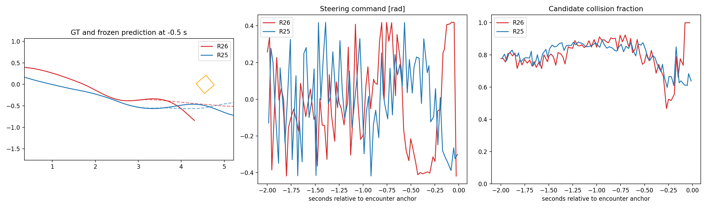

# PP 기반 회피의 한계에서 MPPI 검증과 SVG-MPPI 후속 연구로

> **2026-11-18 갱신:** 이 보고서는11/1당시결과다. 11/12 consistent_v1 추가실행 R27~R34는 [결과표](results_summary.csv)와 [최신 보고서](../EXP-009/REPORT.md)에 반영했다. 수정 MPPI의 HYHALL3.0m/s 5회35랩완료와 이후Berlin 실패/역주행/guard정지·계산회귀를 구분한다. 아래 clearance_v1의3회중1회성공은과거버전결과로보존한다.

2026-10-31~2026-11-01, HYHALL12 시뮬레이션. 실제 차량 시험 없음.

기존 PP 기반 시스템에서 확인한 **여러 장애물에 대한 회피 경로 생성·점유 판정·상태 전환 문제**를 보완하기 위해 MPPI를 적용했다. MPPI는 저속에서 연속 회피 주행을 보였지만, 같은 설정에서 성공과 충돌이 갈렸고 3.0m/s에서는 세 실행 중 한 번만 7랩을 완료했다. 다음 연구 질문은 SVG-MPPI의 가이드 기반 탐색이 이 회피 불안정성을 줄이는지다. SVG의 우수성이나 연산 시간 단축을 확인한 결과는 아니다.

## 1. PP에서 무엇을 확인했는가

대상은 PP 추종기 단독이 아니라 **spline 회피 플래너＋상태 머신＋PP**다.

### 확인된 정지 메커니즘

GT, 장애물 2개, 배율 0.25의 EXP-003/R02-retry2에서 첫 장애물을 피하는 경로가 두 번째 장애물의 점유 검사에 걸렸다. `_check_ofree`의 O_FREE=False, OVERTAKE→TRAILING, 속도 명령 0이 로그와 bag 재구성에서 일치했다. 가장 가까운 장애물 중심으로 생성하는 spline과 다른 전방 장애물까지 검사하는 상태 머신 사이에서 회피가 거부되는 구조를 확인했다. 이것은 이번 배치의 **플래너·상태 전환 문제를 확인한 근거**이며, 모든 실패의 원인이 플래너 하나라고 확정하는 근거는 아니다.

- [기존 원인 보고서](../EXP-003/REPORT.md)
- [GT 0.70에서도 정지한 대조 기록](../../runs/EXP-006/R01/README.md)

### 경로 방향 급변과 충돌

PF, 배율 0.70의 EXP-004/R07 계열은 3랩을 통과한 뒤 네 번째 배치에서 충돌했다. R07-retry3에서는 같은 s 부근 회피 목표가 약 0.1초 사이 d=-0.541m에서 +0.472m로 바뀌었다. 차량은 기존 쪽에 남았고, 이후 정지 명령에도 실제 속도가 남아 충돌했다. 방향 전환의 정확한 내부 트리거와 각 지연의 기여는 미확정이다.

- [경로 급변 분석](../../runs/EXP-004/R07-retry3/README.md)

### PP도 통과한 기록이 있다

| 조건 | 관찰 |
|---|---|
| PP/PF/장애물 2개/배율 0.70 | 여러 실행에서 3랩 무충돌 후 4번째 배치 충돌. 대표 평균 12.374초, 실제 GT 최고 vx 7.014m/s |
| PP/PF/장애물 2개/배율 0.75 | 최초 1랩 후 충돌, 반복에서는 정지 |
| PP/GT/장애물 2개/배율 0.70 | 첫 배치 정지, 0랩 |

배율은 m/s가 아니다. PP는 구간별 속도와 감속을 사용하고 MPPI는 고정 속도이므로, 현재 자료로 MPPI가 동일 속도에서 PP보다 우수하다고 결론 내리지 않는다. PF/GT 차이도 있다. 과거 7랩 성공으로 언급된 EXP-007/R09는 **TLN/PF/배율 0.50/장애물 1개**이며 PP 0.75의 결과가 아니다.

## 2. MPPI 적용 범위와 환경

- 공식 원본: [kohonda/proj-svg_mppi](https://github.com/kohonda/proj-svg_mppi), 커밋 `f4fb7b74f12d4568790213aab26dd6f0538d1925`. 원본 체크아웃은 변경하지 않았다.
- 공식 구현은 ROS 1 Noetic. 이번 실행은 별도 ROS 2 Humble 어댑터다. 공식 ROS 1 구현을 그대로 실행했다고 표현하지 않는다.
- Codex 작업 환경은 Ubuntu 22.04 컨테이너이며 Docker CLI/소켓이 없었다. 기존 ROS 2 시뮬레이터에 별도 어댑터를 연결했다.
- HYHALL12의 `hyhall12_orig.yaml`, 기존 출발 pose, IQP 글로벌 waypoint를 사용한다. 원본 저장소 기본 맵 실험은 이번 기록에 포함되지 않는다.
- GT `/car_state/odom_GT`로 위치·속도를 입력한다. 기존 PP/TLN/회피 플래너와 동시에 제어하지 않으며 `/mppi_sim/drive`만 시뮬레이터에 연결한다.
- MPPI가 직접 조향을 계산한다. **MPPI＋PP 직렬 결합이 아니다.** 최적화 입력은 조향 1개이고, 속도는 고정 명령/기준 속도장이다. 속도·조향 공동 최적화와 자동 위험 감속은 없다.
- reference와 local costmap은 ROS 2 어댑터에서 생성한다. scan 점유 팽창, nearest-waypoint reference 등은 공식 입력 파이프라인과 다르다.
- 기본 1,000 samples, OpenMP 4 threads, 25ms 제어 주기. GPU는 사용하지 않았다.
- 최종 주요 조건: 예측 상태 45개, 간격 0.05초 → 44전이의 약 2.2초. 2.5m/s에서 명목 5.5m, 3m/s에서 6.6m다.
- collision rate는 **샘플 중 충돌 비용이 양수인 비율**이다. 실제 충돌 확률, 최종 가중 평균 궤적의 안전 보장, 자동 정지 조건이 아니다.
- 충돌 종류는 simulator LiDAR iTTC 트리거 분류이며, 정확한 차체 사각형 교차 판정과 구분한다.

현재 환경은 [environment.json](environment.json), 실행별 조건·해시는 [실행 자료](../../runs/EXP-008/), 전체 결과는 [results_summary.csv](results_summary.csv)에 있다. 중단·미실행·설정 확인용 세션도 삭제하지 않았다.

## 3. 빌드와 실행 버전의 구분

| 버전 | 내용 |
|---|---|
| upstream | 원본 solver를 복사한 초기 ROS 2 어댑터 |
| repro_v1 | OpenMP sampler의 가변 normal_distribution 공유를 작업 스레드별 사본으로 분리 |
| speed_v1 | repro_v1을 유지하고 어댑터 속도 상한만 2→3m/s로 확장 |
| clearance_v1 | speed_v1에 scan 기반 soft clearance layer와 stage/terminal 비용 추가 |

sampler의 고정 입력 검사는 원본 4 threads에서 50/50 불일치, 수정 후 0/50 불일치를 보였다. 수정 solver의 합성 고정 입력 15쌍도 일치했다. 이것은 **고정 입력 재현성 수정**이며 비동기 ROS 폐루프 전체의 동일 궤적을 보장하지 않는다. [진단 자료](diagnostics/sampler_repro_20261031/)

단순 Docker 이미지 빌드와 프로젝트 빌드는 별개다. 이번에는 기존 컨테이너에서 별도 colcon workspace를 빌드했다. ROS 1 catkin 빌드를 완료했다고 표현하지 않는다. race_stack 작업 트리는 별도이며 기존 변경을 덮어쓰지 않았다.

## 4. 실험 진행과 결과

### 기준 동작과 예측 범위

1m/s에서 15→30 states로 늘리며 장애물 없는 기준 주행을 확인했다. 30 states의 장애물 2개 조건에서는 원본 sampler의 성공·실패 변동을 관찰했고 별도 repro_v1에서 3×3랩 성공을 확인했다. 이후 45 states와 속도 증가를 탐색했다. 계산 시간은 실행 시점의 CPU·전력·부하 조건이 완전히 통제되지 않았으므로 서로 다른 날의 결과를 알고리즘 속도 향상으로 해석하지 않는다.

### 대표 결과

| 실행 | m/s | 장애물 | 버전 | 완료 랩 | 완료 랩 평균(s) | 종료/전체 충돌 |
|---|---:|---:|---|---:|---:|---|
| [R06_repro_obstacles2](../../runs/EXP-008/20261031T233309_16976_forward_mppi_R06_repro_obstacles2/) | 1.0 | 2 | repro_v1 | 3 | 43.657 | lap_target / 0 |
| [R07_repeat2](../../runs/EXP-008/20261031T234039_17876_forward_mppi_R07_repeat2/) | 1.0 | 2 | repro_v1 | 3 | 43.677 | lap_target / 0 |
| [R08_repeat3](../../runs/EXP-008/20261031T234040_17902_forward_mppi_R08_repeat3/) | 1.0 | 2 | repro_v1 | 3 | 43.653 | lap_target / 0 |
| [R09_horizon45](../../runs/EXP-008/20261031T234808_19249_forward_mppi_R09_horizon45/) | 1.0 | 2 | repro_v1 | 3 | 41.760 | lap_target / 0 |
| [R10_speed1p5](../../runs/EXP-008/20261101T134057_1694_forward_mppi_R10_speed1p5/) | 1.5 | 2 | repro_v1 | 3 | 27.193 | lap_target / 0 |
| [R11_speed2p0](../../runs/EXP-008/20261101T135202_2578_forward_mppi_R11_speed2p0/) | 2.0 | 2 | repro_v1 | 3 | 20.460 | lap_target / 0 |
| [R12_speed2p5](../../runs/EXP-008/20261101T135628_3603_forward_mppi_R12_speed2p5/) | 2.5 | 2 | speed_v1 | 3 | 16.510 | lap_target / 0 |
| [R13_speed2p5_laps7](../../runs/EXP-008/20261101T140052_4317_forward_mppi_R13_speed2p5_laps7/) | 2.5 | 2 | speed_v1 | 1 | 16.818 | first_collision / 1 |
| [R14_speed2p5_laps7_repeat](../../runs/EXP-008/20261101T140552_5164_forward_mppi_R14_speed2p5_laps7_repeat/) | 2.5 | 2 | speed_v1 | 7 | 17.253 | lap_target / 0 |
| [R15_validation1](../../runs/EXP-008/20261101T141920_5976_forward_mppi_R15_validation1/) | 2.5 | 2 | speed_v1 | 7 | 16.607 | lap_target / 0 |
| [R16_validation2_retry1](../../runs/EXP-008/20261101T142922_7188_forward_mppi_R16_validation2_retry1/) | 2.5 | 2 | speed_v1 | 7 | 16.635 | lap_target / 0 |
| [R17_validation3](../../runs/EXP-008/20261101T143238_7841_forward_mppi_R17_validation3/) | 2.5 | 2 | speed_v1 | 7 | 16.639 | lap_target / 0 |
| [R18_obstacles4](../../runs/EXP-008/20261101T143721_8710_forward_mppi_R18_obstacles4/) | 2.5 | 4 | speed_v1 | 4 | 16.705 | first_collision / 1 |
| [R19_obstacles4_repeat](../../runs/EXP-008/20261101T144444_9530_forward_mppi_R19_obstacles4_repeat/) | 2.5 | 4 | speed_v1 | 7 | 16.696 | lap_target / 0 |
| [R20_obstacles4_repeat3](../../runs/EXP-008/20261101T144830_10236_forward_mppi_R20_obstacles4_repeat3/) | 2.5 | 4 | speed_v1 | 7 | 16.714 | lap_target / 0 |
| [R21_clearance_retry1](../../runs/EXP-008/20261101T150220_12046_forward_mppi_R21_clearance_retry1/) | 2.5 | 4 | clearance_v1 | 7 | 16.994 | lap_target / 0 |
| [R22_clearance_repeat2](../../runs/EXP-008/20261101T150845_12784_forward_mppi_R22_clearance_repeat2/) | 2.5 | 4 | clearance_v1 | 7 | 17.046 | lap_target / 1 |
| [R23_clearance_repeat3](../../runs/EXP-008/20261101T151320_13516_forward_mppi_R23_clearance_repeat3/) | 2.5 | 4 | clearance_v1 | 7 | 16.982 | lap_target / 0 |
| [R24_clearance_speed3p0](../../runs/EXP-008/20261101T151855_14283_forward_mppi_R24_clearance_speed3p0/) | 3.0 | 4 | clearance_v1 | 1 | 14.430 | first_collision / 1 |
| [R25_clearance_speed3p0_repeat](../../runs/EXP-008/20261101T152128_15033_forward_mppi_R25_clearance_speed3p0_repeat/) | 3.0 | 4 | clearance_v1 | 7 | 14.266 | lap_target / 0 |
| [R26_clearance_speed3p0_repeat3](../../runs/EXP-008/20261101T152429_15732_forward_mppi_R26_clearance_speed3p0_repeat3/) | 3.0 | 4 | clearance_v1 | 3 | 14.197 | first_collision / 1 |

충돌 실행의 평균은 완료한 랩만 포함하며 미완료 랩은 제외한다. 성공 실행과의 속도 비교에 그대로 사용하지 않는다.

### 장애물 2개: 연속 완주와 남은 변동

R15/R16-retry1/R17은 2.5m/s에서 각 7랩 무충돌, 합계 21랩이다. 평균은 16.607/16.635/16.639초이고 실제 7개 배치도 같다. 그러나 앞선 R13은 같은 속도에서 2랩째 벽에 충돌했으며 실패 이력을 제외하지 않는다. 독립 실행 3회와 한 실행 안의 7랩을 구분한다.

### 장애물 4개: 같은 배치에서 회피 방향이 달라짐

R18은 4랩 완료 후 5랩째 장애물 충돌, R19/R20은 7랩 완료다. 이전 충돌 x 부근에서 R18의 y=-0.387m에 비해 R19/R20은 +0.489/+0.480m였다. 실제 첫 5개 배치, 설정, 바이너리는 같다. 오른쪽 고정 선택 알고리즘으로 단정할 수 없으며 **동일 조건의 폐루프에서 회피 방향과 결과가 변동**함을 관찰했다. 3회 중 2회 완주 기록을 일반 성공 확률로 해석하지 않는다.

## 5. 여유 거리 비용 추가의 효과와 한계

기존 inflated collision layer는 그대로 유지했다. 그 바깥 거리 d에 다음 비용을 각 예측 상태와 terminal에 추가했다.

`clearance_cost(d) = 5 × max(0, 1 − d / 0.30m)²`

- 기존 scan 기반 팽창 영역까지의 거리이며 실제 차체 표면 여유가 아니다.
- 충돌 비용과 별도로 합산해 sample collision rate의 의미를 유지했다.
- 시야 가림·미관측 영역은 여전히 한계다. hard constraint나 안전 보장이 아니다.
- fixed 30cm와 가중치 5는 초기 시험값이며 최적값이 아니다.
- 기록된 scan에서 기존 binary collision layer가 바이트 수준으로 같고 추가 margin 비용이 생성되는지 검사했다. 합성 solver 검사는 추가 비용만 증가하고 충돌 비용은 동일함을 확인했다.
- [입력·solver 검사](diagnostics/clearance_checks/), [소스 사본](../../configs/EXP-008/reproduction/ws_clearance/src/)

| 지표 | 기존 R19/R20 | clearance R21/R22/R23 |
|---|---|---|
| 목표 7랩 | 각 성공 | 각 성공 |
| 평균 랩타임 | 16.696 /16.714초 | 16.994 /17.046 /16.982초 |
| 장애물별 최근접 중심 거리 중앙값 | .488 /.476m | .603 /.606 /.595m |
| 전체 최소 중심 거리 | .398 /.415m | .414 /.431 /.450m |
| 조향 TV(rad/s) | 1.784 /1.740 | 1.894 /1.748 /1.750 |

모든 통과 장애물 중심과의 최근접 거리를 encounter별로 계산한 중앙값이다. 최소 차체 표면 clearance와 구분한다. 일반적인 이격 증가가 반복 관찰됐지만 최악 여유의 일관된 개선이나 진동 감소를 확정하지 않는다. 기존 3회와 변경 3회는 작은 한 seed 표본이며 충돌률 개선의 통계적 증명이 아니다.

R21 최초 시도는 컨트롤러 실행 증거가 없고 0랩이므로 유효 주행에서 제외하고 기록은 보존했다. R22는 목표 7랩까지 무충돌이나 종료 약4.912초 뒤 벽 충돌 1회가 전체 bag에 있다. 종료 시 drive 0 누락과 마지막 2.5m/s 명령 지속을 확인했다. 이후 harness가 controller 종료 후 정지 명령을 반복 송신하도록 수정했고 R23에서 실제 정지를 확인했다. R22를 전체 무충돌로 표기하지 않는다.

## 6. 3.0m/s 실패와 성공을 새로 비교한 결과

- R24: 1랩14.430초 완료, 2랩째 왼쪽 곡선에서 장애물을 피하다 안쪽 벽 충돌.
- R25: 7랩 무충돌, 평균14.266초, 최단13.820초.
- R26: 3랩14.410/14.361/13.819초 완료 후 4랩째 아래쪽 장애물 회피 중 벽 충돌.

세 실행은 같은 clearance 설정과 바이너리다. 3회 중 1회만 목표 완료했다. 단일 배치 한계 하나가 아니라 **서로 다른 장애물 접근에서 회피 조향이 불안정해지는 현상**이다. 속도 3m/s 자체가 통과 불가능하다는 결론은 아니다.

실선은 GT, 점선은 encounter anchor 0.5초 전의 고정 예측이다. 빨강은 실패 R26, 파랑은 성공 R25의 같은 4랩 구간이며, 두 anchor는 같은 x 부근으로 정렬했다. 주황은 당시 장애물 사각형이다. 회피 진입 상태는 이미 달라져 있다. 그림의 시각 정렬이 모든 상태·입력의 동일성을 의미하지 않는다.

### 확인된 사실

1. R26은 장애물 아래로 진행하다 GT(4.306,-.841)에서 벽 충돌. 직전0.05초 +.4189rad, 충돌 무렵 -.4189rad의 조향 반전이 기록됐다. 실제/명령 속도는3m/s였다.
2. R24는 GT(-3.209,2.154)에서 벽 충돌. .2초 전 조향+.4188rad, .05초 전-.3774rad. R25는 같은 배치에서 진행 방향을 유지하며 통과했다.
3. 실패 직전 모든 샘플에 충돌 비용이 있는 구간이 있다. collision fraction이 다시 낮아지는 순간도 실제 안전 회복을 보장하지 않았다.
4. 공개된 최종 예측 경로를 직전 수신 grid에 투영하면, 충돌 비용 영역에 들어가는 예측 상태가 있는 순간이 성공·실패 양쪽에서 확인된다. 비용 최적화 결과를 hard safety filter로 검증해 거부하는 구조는 없다. grid 결합은 비동기 근사다.
5. R26의 실패0.5초 전 예측과 이후 실제 위치의0.5초 차이는 약0.403m, 성공 R25 대응 표본은 약0.101m였다. 그러나 미래에는 재계획 명령이 적용되므로 **이 차이를 모델 오차 단독의 측정값으로 해석할 수 없다.** .1/.25초 구간은 다른 양상을 보이고 성공 실행에서도 예측 차이가 발생한다.
6. 종료 후 정지 문제와 주행 중 회피 충돌은 별개다. R24/R26은 종료 정지0 확인, R25도 bag 최종 속도가 사실상0이었다.

[2랩 비교 그림](diagnostics/speed3_failure_review_20261101/R24_vs_R25.png), [비동기 표본·예측 비용·단기 차이 상세](diagnostics/speed3_failure_review_20261101/comparison.json), [분석 스크립트](../../configs/EXP-008/reproduction/tools/analyze_speed3_failures.py).

### 코드에서 확인한 구조와 아직 확정하지 않은 원인

- 주로 이전 계획 주변에서 샘플을 생성하고 후보 조향 시퀀스를 가중 평균한다. 장애물 좌우처럼 서로 다른 경로 군집을 유지·선택하는 탐색이 어려운 원인 후보다. 현재 bag에는 모든 후보/가중치/전체 control sequence가 없어 실제 모드 혼합을 입증하지 못했다.
- 예측은 1차 조향 지연을 가진 kinematic bicycle이며, simulator는 조향 변화율 제한과 차량 동역학을 사용한다. 어댑터의 steer state는 측정된 조향값이 아니라 명령으로 추정한다. 동역학 불일치 기여가 가능하지만 현 자료만으로 지연 파라미터를 식별하지 않았다.
- **전역·로컬 예측의 초기 조향이 불일치한다.** 전역은 어댑터가 추정한 steer state로 시작하지만 로컬은 0으로 초기화되고 속도만 복사된다. reference 비용과 표시용 경로는 전역 예측, 장애물·여유 비용은 로컬 예측을 사용한다. 조향 중에는 두 경로가 같은 물리 궤적의 좌표 변환이 아닐 수 있다.
  - 실제 빌드된 clearance_v1 solver의 합성 검사에서 초기 steer=.3rad/속도3m/s/향후 명령0일 때 첫 전역 예측은(.148368,.022065)m였다. 이 점의5mm 단일 grid cell에 비용100을 놓았지만 solver의 collision cost는0이었다. [합성 검사 결과](diagnostics/speed3_failure_review_20261101/coordinate_probe_result.json), [검사 코드](diagnostics/speed3_failure_review_20261101/coordinate_consistency_probe.cpp).
  - 매우 좁은 합성 단일 셀을 사용해 **좌표 일관성 문제를 분리 재현**한 검사다. 실제 팽창 장애물을 못 봤다는 증명이나 R24/R26 충돌의 직접 인과 증명은 아니다. 측정되지 않은 실제 조향 상태와 동역학 차이도 남아 있다.
  - MPPI와 SVG가 같은 MPCBase를 공유하므로 SVG만 전환해 해결됐다고 주장하면 안 된다. 실제 주행 소스는 이번 진단에서 수정하지 않았고, 공통 예측의 초기 상태 일관성 검증·수정은 후속 비교의 선행 항목이다.
- 비용에 조향 변화량의 명시적 시간차 벌점이 없으며, 입력 크기 관련 항과 조향 변화율 벌점은 다르다. post-filter를 추가하면 실제 입력과 rollout의 일관성도 유지해야 한다.
- soft clearance는 좁은 경로의 비용을 올리지만 조향 반전·불확실한 예측·위험 시 정속 진행을 직접 해결하지 않는다.

따라서 최종 진단은 **회피 경로 선택과 조향의 반복 안정성 부족, 최종 경로 안전 검증 및 위험 시 감속 부재**다. “평균화 하나가 원인”, “연산 때문에 충돌”, “PF를 사용하면 해결” 등으로 확정하지 않는다. 사용자의 요청으로 이번 단계에서는 연산 최적화를 보류한다. 다만 계산 시간은 결과에서 숨기지 않는다.

## 7. SVG-MPPI로 이어지는 연구 질문

[원 논문](https://arxiv.org/abs/2309.11040)은 빠르게 변하는 다봉형 행동 분포를 다루기 위한 가이드 기반 MPPI를 제안한다. 현재 구현도 guide 입자를 이동시키고 그 결과로 nominal과 sampling covariance를 구성한다. 따라서 MPPI에서 관찰된 불안정한 회피 탐색을 보완할 **검증 후보**로 연결한다.

**가설:** 같은 장애물 배치와 속도에서 가이드 기반 탐색이 충돌 없는 유효 후보를 확보하고 회피 방향의 급변·조향 진동을 줄이는가?

SVG가 더 넓은 통로 선택, 안전 정지, 모델 불일치 해결 또는 계산 시간 단축을 자동 보장하는 것은 아니다. 추가 guide/gradient 평가 때문에 계산량이 늘 수 있다. 동일 sample batch는 동일 계산 예산이 아니다. “연산 문제의 해결”보다 **탐색 효율과 회피 안정성 개선 검증**으로 기술한다.

### 이미 수행한 SVG 예비 실행도 보존

S01은1m/s·장애물2개·30states·원본 sampler에서2랩 후3랩째 벽 충돌했고, solver 평균13.831ms/p9523.889ms였다. 이후 MPPI repro_v1/clearance/45states/3m/s와 조건이 달라 현재 비교 결론에 사용하지 않는다. SVG를 아직 한 번도 실행하지 않았다고 쓰거나 이 실패를 숨기지 않는다.

### 다음 비교 설계 — 아직 실행하지 않음

1. 현재 MPPI 기준값과 실패 이력을 동결한다. 속도/위치/실제 장애물/초기상태/모델/예측 범위를 맞춘다.
2. 전역/로컬 초기 조향의 불일치와 최종 경로의 점유 비용을 먼저 공통으로 검증한다. 필요한 수정은 MPPI/SVG 양쪽에 적용하고 새로운 MPPI 기준을 다시 확보한다. 그 다음 같은 clearance 비용으로 비교한다. sampler의 공유 분포 문제 수정이 SVG 활성 경로에도 충분한지 점검한다.
3. 기본 동작 비교와 계산 예산 비교를 분리한다. 같은1,000 samples 비교 외에도 같은 시간 예산 조건을 별도로 검토한다.
4. 독립 반복별7랩 성공 여부, 충돌 종류·위치, 정지, 회피 방향 전환, 조향TV, encounter별 차체 여유(현재 중심거리와 구분), 랩타임, p95/최대 계산시간을 보고한다.
5. seed2027/2028을 학습·튜닝에 쓰지 않은 검증 배치로 남긴다. 기본 MPPI/clearance/SVG 효과가 섞이지 않도록 구분한다.
6. PPO 등 강화학습과 다른 맵 이식은 이후 단계다. 오늘 실행을 추가로 자동 시작하지 않았다.

## 8. 자료 구성·재현·제한

- [전체 실행별 표](results_summary.csv): 초기 GUI 점검·중단·미실행 포함35개 세션. 이 전체를35개 유효 성능 실험으로 계산하지 않는다.
- [실행별 설정·로그·분석·그림](../../runs/EXP-008/): 원본 run 이름 유지. `conditions.json`, `session.json`, executable/config SHA, 실행 명령, 당시 runner 사본 포함.
- [소스·설정 사본](../../configs/EXP-008/): 4개 workspace source 변형, tuning, 실행/분석 도구, 일부 의존 소스. upstream MIT LICENSE 보존. 현재 도구 사본은 역사적 모든 실행의 당시 도구와 같다고 주장하지 않으며, run별 runner/해시를 우선한다.
- [재현 안내](../../configs/EXP-008/REPRODUCE.ko.md), [로컬 bag 위치·크기 목록](local_bag_inventory.json). 원본 bag 약25GB는 로컬 보존하고 GitHub에는 업로드하지 않는다. 대용량 영상도 미수신이다.
- 결과는 현재 ROS2 어댑터의 한 맵·주로 한 seed다. 논문의 공식 벤치마크 재현이나 실차 안전성을 검증한 결과가 아니다.
- 이번 게시 대상은 **실험 기록 저장소**다. 별도 race_stack 소스 저장소를 commit/push한 것으로 표현하지 않는다.
