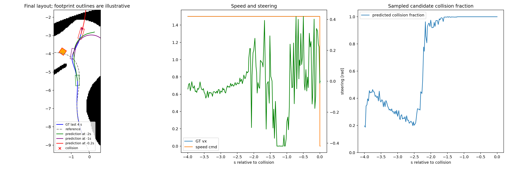
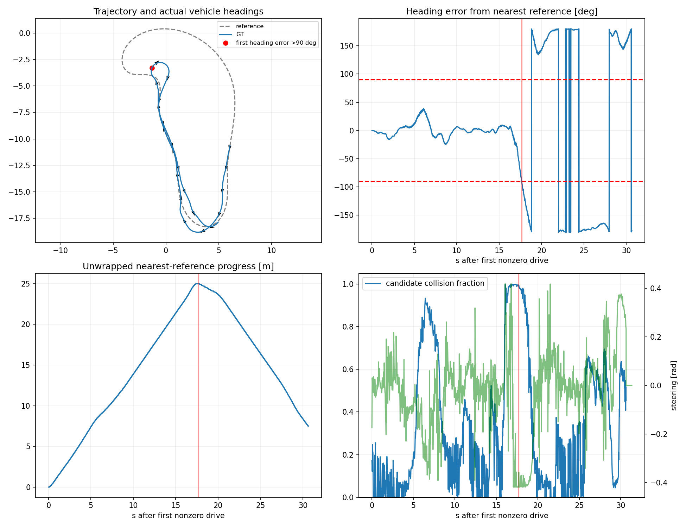

# Berlin 최종 평가 맵에서의 MPPI·SVG-MPPI 검증과 현재 한계

기록 기준: **2026-11-18, B07 종료 후**. 모든 주행은 시뮬레이션이며 실제 차량 실험은 없다. 발표 예정일은 사용자 확인 기준 2026-12-16이다.

**현재 결론:** HYHALL12에서는 초기 조향 상태를 일치시킨 MPPI가 3.0m/s로 5회·총 35랩을 완료했다. 그러나 Berlin에서는 기존 MPPI·SVG가 첫 랩에서 실패했다. 차량의 미래 방향을 반영하는 충돌 검사를 추가한 MPPI는 1랩(33.049초)을 완료한 뒤 두 번째 배치에서 벽에 충돌했고, 같은 공통 검사를 사용한 SVG는 U턴하여 역주행했다. 전방 진행과 최종 궤적 검증을 추가한 최신 SVG는 약 10.26m에서 정지했다. **Berlin 회피·완주 문제는 미해결이며, SVG의 성능 개선은 입증하지 못했다.** 최신 버전의 계산 시간 회귀도 해결 전이다.

## 1. PP → MPPI → SVG로 진행한 이유와 주장 범위

기존 시스템은 spline 회피 플래너 + 상태 머신 + PP 추종기다. GT·장애물 2개에서 회피 경로가 두 번째 장애물의 점유 검사에 걸려 `O_FREE=False → TRAILING → 속도 0`으로 이어지는 메커니즘을 확인했다. PF에서는 여러 실행이 3랩을 통과한 뒤 네 번째 배치의 회피 방향 급변·충돌도 관찰됐다. 따라서 “PP는 항상 한 랩도 못 돈다”, “모든 실패가 플래너 하나의 문제로 확정됐다”는 표현은 사용하지 않는다.

MPPI는 여러 미래 조향 시퀀스를 예측하고 경로·장애물 비용을 함께 평가하는 방법으로 적용했다. **현재 MPPI는 직접 조향을 계산하며 MPPI+PP 결합이 아니다.** 고정 속도 조건에서 회피 안정성, 입력·예측 모델의 일치, 비용 설계를 검증했다. SVG는 가이드 기반 샘플 탐색이 남은 실패를 줄일 수 있는지 검증할 가설이었다. 실제 비교에서 개선이 없었으므로 결과를 그대로 보존한다.

PP의 배율 기반 속도 정책과 MPPI의 고정 m/s, GT/PF, 지도·배치가 다른 과거 실행을 같은 조건의 우열 비교로 제시하지 않는다. Berlin에서 속도·측위·장애물 배치·차량 모델을 맞춘 PP 대조 결과는 아직 없다. 상세한 PP 근거는 [EXP-008 보고서](../EXP-008/REPORT.md)와 그 안의 EXP-003/004/006 링크를 참조한다.

## 2. 구현과 환경

| 항목 | 실제 사용 내용 |
|---|---|
| 원본 저장소 | [kohonda/proj-svg_mppi](https://github.com/kohonda/proj-svg_mppi) |
| 원본 기준 커밋 | `f4fb7b74f12d4568790213aab26dd6f0538d1925` |
| 원본 환경 | ROS 1 Noetic 구현 |
| 이번 환경 | Ubuntu 22.04 / 기존 컨테이너 / ROS 2 Humble 별도 어댑터 |
| ROS 1 빌드 여부 | 이번 결과를 Noetic/catkin 공식 실행으로 표현하지 않음 |
| 계산 | CPU OpenMP 4 threads, GPU 미사용 |
| 제어 입력 | 조향 1개. 기본 목표 속도 고정, 속도·조향 공동 최적화 아님 |
| 차량 | lf .15875m, lr .17145m, 차체 .58×.2032m, 조향 ±.4189rad |
| 예측 | 상태 45개, 간격 .05초 = 44전이, 약 2.2초 |
| 제어 주기 목표 | .025초(40Hz). 실제 deadline 충족 여부는 별도 측정 |
| 입력 | scan, GT odom, local costmap, reference field/path |
| 변경 보존 | 기존 race_stack 작업 트리·과거 workspace·bag을 덮어쓰지 않고 variant별 별도 workspace 사용 |

이 저장소의 `configs`는 재현용 사본이다. 기존 race_stack 소스 저장소에 commit/push한 것이 아니다. 공식 solver의 수정 없는 성능과 이번 ROS 2 입력·비용·정지 정책을 구분해야 한다. [변형 소스와 재현 안내](../../configs/EXP-009/REPRODUCE.ko.md).

## 3. 11월 12일 HYHALL12 추가 검증

이전 보고서의 3.0m/s 성공 1/3 결과는 `clearance_v1` 당시 기록이다. 이후 `consistent_v1`에서 전역·로컬 예측의 초기 조향을 동일하게 했다. 기존 로컬 초기 조향 0과 전역 추정 조향의 불일치로 합성 fixture에서 “발행된 예측 첫 점은 비용100인데 solver 충돌 비용은0”인 상황을 재현했고, 수정 후 동일 좌표 검사에서100으로 일치했다. 이것은 좌표·상태 일치 수정이며 과거 충돌 전체의 단독 원인 입증은 아니다.

| 속도 | 실행 | 각 실행 완료 랩 | 각 실행 완료 랩 평균 | 관찰 |
|---|---|---|---|---|
| 2.5m/s | R27/R28/R29, seed2026 | 7/7/7 | 17.109 / 17.069 / 17.120초 | 총21랩, 통합 평균17.099초 |
| 3.0m/s | R30/R31/R32, seed2026 | 7/7/7 | 14.419 / 14.487 / 14.488초 | 총21랩, 통합 평균14.465초 |
| 3.0m/s | R33 seed2027 / R34 seed2028 | 7/7 | 14.397 / 14.392초 | 새 seed별1회 |

3.0m/s 전체 5회·35랩 통합 평균은 **14.437초**다. 모두 해당 실행에서 목표7랩 무충돌 완료한 관찰이며 다른 지도·배치의 성공 보장은 아니다. R27~R34는 [EXP-008 실행 기록](../../runs/EXP-008/)에 추가했고, 전체 날짜별 결과는 [기계 판독용 결과표](results_summary.csv)에 포함했다.

## 4. Berlin 지도·경로·출발 상태

교수 공개 자료를 사용자가 올린 커밋 `a34fb4b04843ad8ebdb77c26e4e1929d4f1eb606`의 `berlin.png`, `berlin.yaml`, `global_waypoints.json`, `speed_scaling.yaml`을 사용했다. 저장소 루트의 원본 파일은 유지한다. 실제 사용 사본과 출발 설정은 [maps/berlin](../../configs/EXP-009/maps/berlin/)에 보존했다.

- 이미지600×600, 해상도.04m, origin(-9.285232,-21.2166344,0).
- 기준 경로는 `global_traj_wpnts_iqp`: 중복 종단 포함489개, 총 길이 약48.784m. 좌표 순서와 ψ 방향을 대조했고 정지 입력 정렬 확인을 통과했다.
- 출발은 사용자 승인으로 IQP waypoint484 부근에 설정: x6.0692266862, y−10.6346335485, yaw−1.7275240459rad. **교수 지정 공식 출발 위치라는 의미는 아니다.**
- `speed_scaling.yaml`의 global_limit=.50은 파일·해시 기록만 한다. 이번 MPPI 구동은 **고정1.0 또는1.5m/s**이며 이 배율이 적용된 속도가 아니다.
- 실제 차량 모델 파라미터는 기존 simulator 설정이다. 공개된 네 파일에 새 차량 모델 파일이 포함됐다는 의미가 아니다.
- simulator와 controller/reference/시각화에서 동일 지도·경로를 사용하도록 입력 경로를 통합했다. GT, scan1080 beams, map600×600, reference489, 장애물4개를 정지 상태에서 확인했다.

## 5. Berlin 실행 결과

모든 유효 실행은 GT·장애물4개·seed2026, 같은 출발·차량 모델이다. B03 이후 명목 속도1.5m/s. 장애물은 랩 완료 후 새 배치로 변경된다. 같은 seed만 확인하지 않고 실제 좌표도 함께 보존했다.

| 실행 | 알고리즘 / 공통 구현 | 속도 | 완료 랩·랩타임 | 종료 결과 |
|---|---|---:|---|---|
| B01 | MPPI / consistent_v1 | 1.0 | 0랩 | 약27.746초, 벽 충돌 |
| B02 | MPPI / B01 동일 반복 | 1.0 | 0랩 | 약27.394초, 벽 충돌 |
| B03 | MPPI / consistent_v1 | 1.5 | 0랩 | 약18.704초, 벽 충돌 |
| B04 **유효 실행** | SVG / svg_repro_v1 | 1.5 | 0랩 | 약18.990초, 벽 충돌 |
| B05 **유효 실행** | MPPI / footprint_v1 | 1.5 | **1랩 / 33.049초** | 약51.135초,두 번째 랩 벽 충돌 |
| B06 | SVG / footprint_v1 | 1.5 | 0랩 | U턴·역주행 후 사용자 중단 |
| B07 | SVG / forward_guard_v1 | 1.5(검증 실패 시0) | 0랩 | 약10.264m 진행 후 guard_stop |

충돌 시각은 runner 시작 기준이고, 방향 분석의 “출발 후”는 첫 비영 속도 명령 기준이다. 시각 원점이 다른 수치를 혼용하지 않는다. 충돌 분류는 simulator LiDAR iTTC trigger 종류이며 독립적인 차체 사각형 교차 판정과 구분한다.

B04의 `20261118T131317_46412...`와 B05의 `20261118T140028_64436...`는 **주행 미실행 준비 세션**이다. 유효 실행은 각각 `134531_53720...`, `140204_66033...`이며 미실행 자료도 삭제하지 않았다. [실행 인덱스](results_summary.csv), [원본 요약 JSON 목록](runs.json), [실행별 자료](../../runs/EXP-009/).

### B01~B04: 속도 상승·SVG 전환만으로 해결되지 않음

1.0m/s 반복에서도 같은 굽이에서 경로를 이탈했고,1.5m/s로 올리거나 SVG로 바꿔도 첫 랩 벽 충돌이 발생했다. 모든 실패가90도초과 역주행으로 분류된 것은 아니며 B03은 충돌 전 해당 조건이 검출되지 않았다. 공통 비용·입력·회전 차체 검사가 먼저 점검 대상이었다.

SVG 비교 전에 `SVGuidedMPPI::approx_grad_log_likelihood`의 OpenMP 공유 행렬 `sum_of_grads += ...` 경쟁을 수정했다. 샘플별 행렬을 계산한 뒤 고정 순서로 합산했고, 고정 입력 병렬15쌍 일치 및 수정 전후 단일 스레드 trace 일치를 확인했다. **스레드가 같은 행렬을 읽는 것 자체가 잘못인 것은 아니며, 동기화 없는 공유 쓰기가 문제였다.** 이 수정이 회피 성능을 개선했다는 결과는 없었다.

### B05: 미래 차량 방향 반영 후 첫 랩 통과, 두 번째 배치 실패

기존 충돌 검사는 현재 ego 축으로 점유 격자를 부풀린 뒤 미래 중심점을 조회했다. `footprint_v1`은 raw scan 점유 셀에 대해 각 예측 상태의 x/y/yaw로 회전하는 안전 직사각형(.70×.30m)을 검사한다. 차체 .58×.2032에 기존 의도한 각측 여유 .06/.0484m를 더한 크기다. soft 여유 .30m/최대5는 유지하되 거리 정의를 사각형 사이 거리로 바꿨고, 차체 전체 grid 밖도 충돌 처리한다. 따라서 yaw만 바뀐 엄밀한 단일 변수 실험은 아니다.

첫 배치는 B03와 동일하고 첫 랩33.049초를 완료했다. 두 번째 랩에는 새 장애물 배치가 들어왔고 벽에 충돌했다. 마지막2초 후보 충돌 비율 평균.99186에도 속도1.5 명령을 유지했다. 단1회의 진전이며 안정화로 판단할 수 없다.

### B06: 같은 공통 검사에서도 SVG가 U턴·역주행

출발 방향 정렬은 정상이었다. 첫 비영 속도 명령+17.666초에 방향 오차−90.706°, 우회전 조향−.4189 포화, 후보 충돌 비율.997을 기록했다. 이후 거의180° 반대 방향으로 주행했고, 최근접 기준 진행량은 최대에서 약17.494m 감소했다. 음수 속도 명령은0회로, 후진이 아니라 **돌아서 양의 속도로 역주행**한 상황이다.

약16.482초의 선택 예측45상태 중24개가 이미 반대 방향이었다. 실제 차량이 정방향 예측과 달리 갑자기 뒤집힌 상황만으로 설명되지 않는다. 공통 비용에 전방 진행 조건이나 역방향 hard rejection이 없고 q_angle=.01로 약했다. 같은 위치에 붙어 반대로 달리는 해가 허용되는 구조를 확인했다. SVG guide·표본·평균화의 개별 기여는 미분리다.

### B07: 진행·검증·정지 정책은 작동했으나 회피 미해결

`forward_guard_v1`은 양 알고리즘에 공통으로 전방 투영 진행 비용, 역방향/충돌 후보 가중치0, 평균 제어 재예측 불가 시 유효 후보 대체, 최종 경로의 최대2cm/2° 간격 보간 검증을 추가했다. 실패 시 목표속도0/기존 조향을 반복 송신하고 정지를 latch한다. 자동 저속 재계획·회복·PPO는 아직 없다.

B07은 `no_collision_free_forward_candidate`로 약10.26m에서 정지했다. guard 수신 후 약.231초·이동 약.127m로 |v|<.05m/s가 됐다. 충돌·역주행은 관측되지 않았지만 **B06의 U턴 지점(진행 약25m)에 도달하기 전에 멈췄으므로 정상 회피 성공이 아니다.** 통로가 물리적으로 없다는 증거도 아니다. 현재 기록에는 충돌·방향 불합격 후보의 개별 계수가 없어 두 사유의 비중을 분리할 수 없다.

## 6. 계산 시간과 최신 회귀

| 실행 | solver 평균 | 전체 cycle 평균 / p95 | 25ms 초과율 |
|---|---:|---|---:|
| B03 MPPI | 12.485ms | 12.760 / 23.364ms | 3.07% |
| B04 SVG | 22.126ms | 22.380 / 37.275ms | 31.18% |
| B05 MPPI·footprint | 13.125ms | 14.922 / 22.302ms | 3.08% |
| B06 SVG·footprint | 22.701ms | 24.119 / 37.616ms | 34.43% |
| B07 SVG·guard | **125.698ms** | **135.031 / 231.388ms** | **100%** |

실행 길이·방문 구간·선택 궤적이 다르므로 동일 프레임의 정밀 profiler 대조는 아니다. SVG와 MPPI의 최종 sample 수가1000으로 같아도 SVG의 guide/gradient 추가 연산 때문에 계산량은 같지 않다. SVG 기본 guide1, gradient samples100, iterations10 등을 유지했다.

B07에서는 새 검증 구현의 **큰 계산 시간 회귀**가 확인됐다. core는-O3지만 node는 최적화 옵션이 없고, 공유 header inline 검사 함수의 비최적화 weak symbol이 실행 파일에 포함되는 경로를 확인했다. 동일O3 core library를 두고 main TU만O0/O3로 바꾼 오프라인 동일 입력 검사에서1.568초 대.685초, 출력 trace는 동일했다. 이 빈맵·1회씩의 진단만으로 실주행 전체5배 악화를 모두 해당 원인으로 확정할 수 없다. **추가 검증·빌드 경로의 회귀를 원래 SVG 알고리즘의 고유 한계로 포장하지 않는다.** 아직 실행 binary의 수정이나 재주행은 하지 않았다.

`collision_rate`는 “horizon 내 양의 충돌 비용이 있는 후보의 비율”이며 실제 충돌 확률이 아니다. B07의 상태 메시지, guard 정지, 후보 통계와 구분해서 해석한다.

## 7. 현재 완료·미완료와 다음 순서

| 완료한 것 | 아직 완료하지 않은 것 |
|---|---|
| Berlin 맵·기준 경로·출발 정렬, GT/scan/costmap 연결 | Berlin 반복 무충돌 완주 |
| HYHALL의 consistent MPPI 반복 결과 보존 | Berlin의 공정한 PP 직접 대조 |
| SVG 공유 행렬 경쟁 수정과 고정 입력 검증 | SVG의 회피·랩타임 개선 입증 |
| 미래 방향 충돌 검사, 전방 후보/최종 경로 검사 | B07 계산 회귀 수정·재측정 |
| 실제 B07 guard 정지 관측 | 실패 사유 계수 분리, 저속 재계획/자동 회복 |
| 학습 적용 구조·발표 일정 초안 | PPO 구현·학습·평가, 속도·조향 공동 최적화 |

다음 작업은 (1) B07 검사/빌드 회귀 수정 후 동일 입력 출력·시간 대조, (2) 정지 입력의 충돌/방향 불합격을 분리하고 모델·실제 목표 속도가 일치하는 낮은 속도 재계획을 검증, (3) 공통 정책을 맞춘 MPPI/SVG 반복 비교다. 과거 성공 설정을 Berlin의 최적 설정으로 간주하지 않는다.

그 뒤 규칙 기반 감속을 기준으로 확보하고, PPO가 목표 속도를 선택하며 MPPI 또는 SVG가 조향하는 상위 속도 정책을 검토한다. 차체 크기나 필수 안전 여유를 학습이 임의로 축소하도록 하지 않는다. 같은 지도라도 학습에서 제외한 장애물 seed로 평가하고 완주율·충돌·정지·실패까지 진행량·완료 랩타임·연산 시간을 함께 비교한다. RL 성능 개선은 아직 측정되지 않았다. [당시 RL 계획 초안](diagnostics/footprint_20261118/RL_PLAN.ko.md)의 날짜는 목표 일정이며 완료 사실이 아니다.

## 8. 자료와 재현 한계

- [실행 결과 CSV](results_summary.csv), [JSON](runs.json): 11/12와11/18 신규17개 세션(실행15, 미실행2).
- [원본 bag 로컬 목록](local_bag_inventory.json): 신규 자료 약23.08GB, Git에 bag/대형 영상/빌드·실행 binary 미포함. 원본은 로컬에서 유지한다.
- [재현 소스·설정](../../configs/EXP-009/REPRODUCE.ko.md): 변형4종, 도구, 사용 지도/시작 위치, simulator 관련 파일 사본.
- [진단 자료](diagnostics/): 초기 조향 일치, SVG 재현성, 회전 차체 기하12,006조건 대조, 합성 guard, Berlin 정지 입력, 제동 수치검사, 빌드 연결 대조.
- 각 실행 폴더의 `session.json`, `conditions.json`, `runner.py`, YAML, controller 로그, 결과 JSON, 지표 CSV, 그림을 우선한다. 과거 진단의 `prepared/not executed` 문구는 작성 시점이며 최종 결과는 이 보고서/실행 summary로 갱신됐다.
- 실험 binary hash는 당시 provenance이며 재빌드 동일 binary를 보장하지 않는다. 기록 경로와 날짜가 로컬 머신 기준이다. source/license를 보존했고 기존 작업공간에 자동 복원하는 자료가 아니다.
